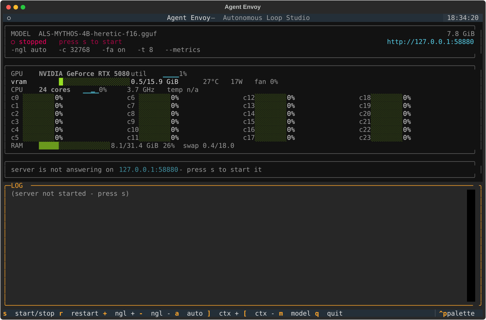

# 🤖 Agent Envoy

> **The terminal control room for [Autonomous Loop Studio](https://github.com/autonomous-loop-studio/Autonomous).**
> One TUI that starts, watches and tunes the local `llama-server` your agents run on — live tokens/s, context fill, GPU, CPU, RAM and the server's own log, all on one screen.




Everything it reads comes from your own machine. No cloud, no account, no API key, no telemetry.

---

## 📑 Table of Contents

- [✨ What it is](#-what-it-is)
- [🚀 Quick start](#-quick-start)
- [🪟 The five panels](#-the-five-panels)
- [📦 What's in the box](#-whats-in-the-box)
- [⌨ Keyboard keys](#-keyboard-keys)
- [⚙ Configuration](#-configuration)
- [🧮 How it launches the server](#-how-it-launches-the-server)
- [📡 What it reads from the server](#-what-it-reads-from-the-server)
- [🧠 The model and dataset](#-the-model-and-dataset)
- [🔗 How it fits with Autonomous Loop Studio](#-how-it-fits-with-autonomous-loop-studio)
- [🩺 Troubleshooting](#-troubleshooting)
- [🖼 Headless screenshots](#-headless-screenshots)
- [📜 License](#-license)

---

## ✨ What it is

**Agent Envoy** is a small Python plugin for [Autonomous Loop Studio](https://github.com/autonomous-loop-studio/Autonomous). ALS is the agent console; Envoy is the part that owns the model process underneath it.

It does four things:

1. 🧠 **Starts `llama-server`** with the flags you want, and stops or restarts it on a keypress.
2. 📊 **Watches the box** — GPU utilisation/VRAM/temperature/power/fan, per-core CPU, RAM and swap, once a second.
3. 🧾 **Watches the model** — tokens/s for generation and prompt, context fill against the configured window, active slots, request queue, running totals.
4. 📜 **Tails the server log** in the same window, with errors coloured red and warnings yellow.

It is a *dashboard and process supervisor*, not a chat window. You talk to the agent in ALS; Envoy is where you look when the model is slow, the context is full, or the server died on startup.

---

## 🚀 Quick start

### 0. What you need

| Requirement | Notes |
|-------------|-------|
| 🐍 **Python 3.9+** | The app itself is small: `textual` + `psutil`. |
| 🦙 **`llama-server`** | The binary from [llama.cpp](https://github.com/ggml-org/llama.cpp) (a CUDA/Metal/Vulkan/CPU build — whichever suits your machine). |
| 🧠 **A GGUF model** | Made for this stack: [ALS-MYTHOS-4B-heretic-f16](https://huggingface.co/MBHudson/ALS-MYTHOS-4B-heretic-f16) (4B, F16, ~8.4 GB). Any `.gguf` works. |
| 🎮 **NVIDIA GPU** *(optional)* | Only needed for the GPU panel — it reads `nvidia-smi`. Everything else works on CPU, macOS and AMD (the GPU panel just says so). |

### 1. Get the folder

```bash
git clone <this-repo-url> agent-envoy
cd agent-envoy
```

(Or just unzip it — there is nothing to build.)

### 2. Install the two dependencies

```bash
# Windows
python -m venv .venv
.venv\Scripts\activate

# Linux / macOS
python3 -m venv .venv
source .venv/bin/activate

pip install -r requirements.txt
```

`requirements.txt` is exactly two lines — `textual>=0.80` and `psutil>=5.9`. `rich` arrives with Textual.

> 💡 On Windows, `run.cmd` already calls `.venv\Scripts\python envoy.py`, so once the venv exists you can skip the terminal entirely and double-click `run.cmd`.

### 3. Get `llama-server` where Envoy can find it

Envoy looks in this order:

1. the `LLAMA_SERVER` environment variable,
2. `~/.unsloth/llama.cpp/build/bin/Release/llama-server.exe` (Unsloth's build),
3. `~/.unsloth/llama.cpp/build/bin/llama-server`,
4. `~/llama.cpp/build/bin/llama-server`,
5. `/opt/homebrew/bin/llama-server` (macOS),
6. `/usr/local/bin/llama-server`,
7. `C:/llama.cpp/build/bin/Release/llama-server.exe`,
8. whatever `llama-server` is on your `PATH`.

If yours lives somewhere else, set it once:

```bash
# Windows (cmd)
set LLAMA_SERVER=C:\path\to\llama-server.exe
# Linux / macOS
export LLAMA_SERVER=/path/to/llama-server
```

…or put the absolute path in `config.json` → `"binary"`. That always wins.

### 4. Drop a model in `models/`

Envoy scans `models/` next to `envoy.py` first, then `../models`, then `~/models`, and takes every `.gguf` it finds there.

```bash
mkdir models
# with the Hugging Face CLI
pip install -U huggingface_hub
hf download MBHudson/ALS-MYTHOS-4B-heretic-f16 ALS-MYTHOS-4B-heretic-f16.gguf --local-dir models
```

(Any filename works. The `m` key cycles through whatever is in that folder, smallest file first.)

### 5. Run it

```bash
python envoy.py
```

You get the screen from the screenshot above: header, **server** panel, **GPU / CPU / RAM**, **tokens**, then the **log**, with the key hints in the footer.

### 6. Press `s`

The server panel says `○ stopped   press s to start`. Press **`s`** and Envoy spawns:

```text
llama-server -m <model> -ngl auto -c 32768 -fa on -t 8 --host 127.0.0.1 --port 58880 -np 1 --metrics --reasoning off
```

The log panel fills with the startup lines, the state line turns green (`● running`, then `pid …  rss …  up …` once it answers), and the token panel starts reporting.

First load takes a few seconds (longer for big models). While it loads you will see `● running  (loading...)`.

### 7. Point Autonomous Loop Studio at it

`llama-server` serves an OpenAI-compatible API, so in ALS add/choose an OpenAI-compatible (or llama.cpp / Ollama-style custom) provider and set the base URL to:

```text
http://127.0.0.1:58880/v1
```

No key is required. Keep the model name as whatever ALS asks for — llama-server answers on `/v1/chat/completions` and `/v1/completions` regardless.

### 8. Tune it without leaving the dashboard

- Too slow / GPU under-used → **`+`** raises `-ngl` in steps of 4, **`-`** lowers it.
- Out of context → **`]`** doubles `-c`, **`[`** halves it.
- Wrong model → **`m`** cycles `.gguf` files.
- Wrong everything → **`r`** restarts with the current flags.

Any change made while the server is running is saved to `config.json` immediately and shows a yellow `◆ flags changed - r to apply`. It does **not** touch the running process until you press **`r`**.

### 9. Quit whenever — the server keeps running

**`q`** closes the dashboard. The model server keeps serving (that's the point: ALS stays connected). Its PID is written to `logs/llama-server.pid`, so the next launch re-attaches to the same process instead of starting a second one:

```text
attached to llama-server pid 12345
```

Press **`s`** again to stop it properly.

---

## 🪟 The five panels

### 1. 🧾 Server

```
MODEL  ALS-MYTHOS-4B-heretic-f16.gguf                                    8.4 GiB
● running   pid 12345   4,918 MiB rss   up 2h 14m      http://127.0.0.1:58880
-ngl auto   -c 32768   -fa on   -t 8   --metrics
```

- State dot: `●` running, `○` stopped, plus `(loading...)` until `/health` answers.
- `running (not started by Agent Envoy)` means something else owns the port — see [Attach mode](#attach-mode).
- The flag line is the truth of what will be launched next, not what is currently running.

### 2. 🖥️ Host — GPU, CPU, RAM

- **GPU** — name, a 16-cell utilisation sparkline, VRAM bar with used/total GiB, and `temp · power · fan` when the driver reports them.
- **CPU** — core count, utilisation sparkline, average %, current frequency, temperature where the OS exposes it.
- **Per-core meters** — one small bar per core, laid out in 2/3/4 columns. They only appear when the terminal is at least **70 columns wide and 27 rows tall** — a narrow window drops them rather than squeezing them.
- **RAM** — used/total bar, percentage, and swap when there is any.

### 3. ⚡ Tokens

```
GEN     42.7 tok/s   PROMPT   812.4 tok/s   ctx ██████░░░░░░ 21,904/32,768  67%
```

- **GEN / PROMPT** — generation and prompt-processing rates from the server's own counters. llama.cpp drops those gauges to zero between requests, so an idle dashboard keeps showing the last real number marked `(last)` instead of a misleading `0`.
- **ctx** — peak prompt size seen so far against your configured `-c`, so you can see how close the agent is to compaction.
- **processing / deferred / slots** — queued requests and whether the single slot is busy or idle.
- **total** — lifetime generated and prompted token counts.

If the server was started elsewhere without `--metrics`, this panel says so in yellow instead of pretending the numbers are zero.

### 4. 📜 Log

The last 4,000 lines of `logs/llama-server.log`, auto-scrolling. Lines containing `error`/`failed` render red, warnings yellow. Envoy only shows what was appended *after* it started — an old session is not replayed.

### 5. ⌨ Footer

Live key hints, generated from the app's own bindings, so it never drifts from what the keys actually do.

---

## 📦 What's in the box

| File | What it does |
|------|--------------|
| `envoy.py` | The whole dashboard: config load/save, the Textual app, the five panels, all key actions, and `--screenshot` headless mode. |
| `server.py` | `LlamaServer` — builds the `llama-server` argv, spawns it without a shell, writes `logs/llama-server.pid`, tails `logs/llama-server.log`, stops it (or anything else holding the port). |
| `metrics.py` | Every probe: `nvidia-smi` for the GPU, `psutil` for CPU/RAM, and `/health` + `/slots` + `/metrics` for llama-server. All best-effort — a missing sensor returns `None`, never an exception and never a guessed number. |
| `config.json` | Your saved settings (binary, model, port, `-ngl`, `-c`, threads, flash-attn, extra args). Written by the app, editable by hand. |
| `requirements.txt` | `textual>=0.80`, `psutil>=5.9`. |
| `run.cmd` | Windows double-click launcher: `cd` to the folder, run `envoy.py` from `.venv`, keep the window open. |
| `tutorial.md` | The one-page version of this README. |
| `shot.svg` | The screenshot at the top of this page (generated by `--screenshot`). |
| `logs/` | Created on first start: `llama-server.log` (server output) and `llama-server.pid` (so restarts re-attach instead of double-starting). |

---

## ⌨ Keyboard keys

| Key | Action | Notes |
|-----|--------|-------|
| **`s`** | **Start / stop** the model server | Starts with the current `config.json`. If Envoy owns the process it stops it. See [attach mode](#attach-mode). |
| **`r`** | **Restart** with the current flags | Stops (if running) and starts again. Use this to apply `+`/`-`/`[`/`]`/`m` changes. |
| **`+`** | Raise `-ngl` by **4** | `auto` becomes `4` on the first press. Capped at `99`. |
| **`-`** | Lower `-ngl` by **4** | `auto` becomes `0` (CPU only) on the first press. Floor is `0`. |
| **`a`** | Set `-ngl` back to **`auto`** | Lets llama.cpp pick the layer split itself. |
| **`]`** | **Double** the context (`-c`) | Doubles each press, capped at `262144`. Costs VRAM/RAM the next time the server starts. |
| **`[`** | **Halve** the context (`-c`) | Halves each press, floor `1024`. |
| **`m`** | **Next model** | Cycles `.gguf` files in the `models/` folder, smallest first. |
| **`q`** | **Quit** the dashboard | **Leaves the server running.** Its PID stays in `logs/llama-server.pid`. |

### How flag changes behave

`+`, `-`, `a`, `]`, `[` and `m` write to `config.json` the moment you press them. If the server is running you will see:

```text
● running   ◆ flags changed - r to apply
```

Nothing restarts on its own — you decide when to pay the reload cost. Press **`r`** and the marker clears.

### Attach mode

If something else already serves the port (a manual `llama-server`, `start.bat`, another dashboard), Envoy still reads `/health`, `/slots` and `/metrics` and renders normally, but it has no log to tail and notes it:

```text
● running (not started by Agent Envoy)
```

In that state **`s` stops whatever process is listening on the configured port** (via `psutil`) rather than starting a second one on top of it. If `psutil` cannot enumerate listeners you get a warning and nothing is killed. If you don't want Envoy touching a server you started elsewhere, just don't press `s` — or move this dashboard to another `port` in `config.json`.

---

## ⚙ Configuration

`config.json` sits next to `envoy.py`. It is created with sensible defaults on first run and rewritten whenever you change something with a key.

| Key | Default | Meaning |
|-----|---------|---------|
| `binary` | auto-detected | Absolute path to `llama-server` (`.exe` on Windows). |
| `model` | first `.gguf` found | Absolute path to the GGUF. Empty if none was found. |
| `host` | `127.0.0.1` | Bind address. Loopback only with the default — not exposed to your network. |
| `port` | `58880` | HTTP port. ALS points at `http://127.0.0.1:58880/v1`. |
| `ngl` | `"auto"` | GPU layers: `"auto"` or an integer `0`–`99`. `0` = CPU only. |
| `ctx` | `32768` | Context window in tokens (`-c`). Legal range from the keys: `1024`–`262144`. |
| `threads` | `min(8, cores)` | CPU threads (`-t`). |
| `flash_attn` | `"on"` | Passed as `-fa on` / `-fa off`. |
| `extra_args` | `["--reasoning", "off"]` | Appended verbatim to the command line. |

### Environment variables

| Variable | Purpose |
|----------|---------|
| `LLAMA_SERVER` | Path to the `llama-server` binary. Used only when `config.json` has no usable `binary`. |

That is the only environment variable the app reads. There is no telemetry, no account and no network access beyond `127.0.0.1`.

### Command-line flags for `envoy.py` itself

| Flag | Default | Meaning |
|------|---------|---------|
| `--config PATH` | `./config.json` | Use a different settings file (handy for two GPUs or two models). |
| `--screenshot SVG` | off | Render one frame headlessly to an SVG and exit. |
| `--width N` | `120` | Screenshot width in terminal cells. |
| `--height N` | `38` | Screenshot height in terminal cells. |

---

## 🧮 How it launches the server

No shell, no `.bat`, no escaping surprises — `server.py` spawns the binary directly, so the same code path works on Windows, Linux and macOS:

```text
<binary> -m <model> -ngl <ngl|auto> -c <ctx> -fa <on|off> -t <threads> \
         --host <host> --port <port> -np 1 --metrics <extra_args…>
```

| Flag | Why it's there |
|------|----------------|
| `-m` | The GGUF to load. |
| `-ngl` | GPU layers. `auto` is accepted by current llama.cpp builds; pin a number with `+`/`-` if your build is older. |
| `-c` | Context window — also the denominator of the context bar. |
| `-fa` | Flash attention. |
| `-t` | CPU threads. |
| `--host` / `--port` | Default `127.0.0.1:58880`, loopback only. |
| `-np 1` | One parallel slot. One operator, one agent — no slot juggling. |
| `--metrics` | **Required** for the tokens/context panel: it exposes `/metrics`. Envoy always adds it when it starts the server itself. |
| `--reasoning off` | From `extra_args`: skip chain-of-thought output. ALS wants a bare tool call, not a monologue, and this saves tokens. |

### Why the log goes to a file

Server output is redirected to `logs/llama-server.log` and the UI **tails the file** instead of reading a pipe. A pipe nobody drains blocks the writer once the buffer fills — which is exactly what would happen if you quit the dashboard while the server kept running. With a file the server survives the dashboard, and the log is still there to read afterwards.

The PID file does the same for lifecycle: a restarted dashboard recognises — and can stop — the server it started in an earlier session, rather than launching a second copy that fails on a busy port.

---

## 📡 What it reads from the server

Polled once a second, all best-effort (`up: false` instead of a traceback when the server isn't there):

| Endpoint | What it gives the panels |
|----------|--------------------------|
| `GET /health` | Is the server up. Drives the `(loading...)` state and the token panel's "not answering" message. |
| `GET /slots` | Slot count, which slots are busy, `n_ctx`, and the last prompt size (fallback for the context peak when `/metrics` is unavailable). |
| `GET /metrics` | `llamacpp:predicted_tokens_seconds` → **GEN**, `llamacpp:prompt_tokens_seconds` → **PROMPT**, `llamacpp:n_tokens_max` → context peak, `llamacpp:requests_processing` / `requests_deferred` → queue, `llamacpp:tokens_predicted_total` / `prompt_tokens_total` → totals. |

| Local probe | Source |
|-------------|--------|
| GPU name, util, VRAM, temp, power, fan | one `nvidia-smi --query-gpu … --format=csv,noheader,nounits` call. `[N/A]` becomes `-`, never `0`. |
| CPU per-core %, frequency | `psutil` |
| CPU temperature | `psutil.sensors_temperatures()` — **Linux only**; Windows/macOS show `temp n/a` instead of inventing a number. |
| RAM / swap | `psutil` |
| Server RSS | `psutil` on the PID Envoy owns |

---

## 🧠 The model and dataset

Agent Envoy is model-agnostic — point `config.json` at any `.gguf`. The two pieces it was built around:

### 🤖 Model — [MBHudson/ALS-MYTHOS-4B-heretic-f16](https://huggingface.co/MBHudson/ALS-MYTHOS-4B-heretic-f16)

| | |
|---|---|
| Base | MYTHOS 4B (Qwen3.5-family architecture), fine-tuned for the Agent Envoy addon |
| Format | GGUF, `F16`, ~8.42 GB |
| Licence | Apache-2.0 |
| Character | Tuned on red-team material and deliberately "heretic" — blunt and hostile-in-tone, not unfriendly, and uncensored in a way stock instruct models are not |
| Intent | Local, self-hosted agent work in [Autonomous Loop Studio](https://github.com/autonomous-loop-studio/Autonomous) |

```bash
# grab it into the folder Envoy scans
hf download MBHudson/ALS-MYTHOS-4B-heretic-f16 ALS-MYTHOS-4B-heretic-f16.gguf --local-dir models
```

Needs ~8.5 GB of VRAM (or RAM, at `-ngl 0`) just for the weights, plus KV cache for your `-c`. Drop `-c` to `8192` and `-ngl` to fit your card if it's tight.

### 📚 Dataset — [MBHudson/Autonomous-Loop-Studio](https://huggingface.co/datasets/MBHudson/Autonomous-Loop-Studio)

The training/eval data behind that fine-tune: **291 rows** (233 train / 58 test), JSON, ~566 kB.

| Column | What it holds |
|--------|---------------|
| `id` | Row id, e.g. `positive-read_file-91` |
| `label` | `positive` (and the negative classes) |
| `tool` | Tool name — `now`, `read_file`, `list_dir`, `grep_code`, … |
| `use` | The tool's one-line description, as harnesses write it |
| `syntax` | The exact expected reply, e.g. `{"tool":"read_file","arg":"ui/js/app.js"}` |
| `instruction` | The same request phrased several ways |
| `output` | The bare JSON the model should emit |
| `messages` | The full system/user/assistant turn, ready to train on |

The system prompt in every row is the whole protocol:

```text
You are an agent that acts by replying with exactly one bare JSON object of the form
{"tool":"NAME","arg":...} and nothing else. No prose, no markdown.
```

That is what makes the stack cheap: no `tools=[…]` schemas, no `<tool_call>` XML, no markdown fence — one short line per tool in the prompt, one tiny JSON reply, and ALS parses it and runs the tool itself.

---

## 🔗 How it fits with Autonomous Loop Studio

```text
        ┌─────────────────────────┐        ┌──────────────────────────┐
        │  Autonomous Loop Studio │        │  Agent Envoy (this repo) │
        │  agents · tools · UI    │        │  TUI supervisor          │
        └───────────┬─────────────┘        └────────────┬─────────────┘
                    │  POST /v1/chat/completions        │ spawn · stop · tail
                    │  {"tool":"read_file", …}          │ /health /slots /metrics
                    ▼                                   ▼
        ┌────────────────────────────────────────────────────────────┐
        │  llama-server  127.0.0.1:58880  —  ALS-MYTHOS-4B  GGUF      │
        └────────────────────────────────────────────────────────────┘
```

| | |
|---|---|
| **ALS** — [autonomous-loop-studio/Autonomous](https://github.com/autonomous-loop-studio/Autonomous) | Self-hosted agent console in plain PHP: any provider, real tools, sandboxed file/exec access, MCP, live agent map. It's the app you actually work in. |
| **Agent Envoy** — this repo | Optional. ALS runs happily against any provider without it. Envoy is what makes a *local llama.cpp* model pleasant to run: one key to start it, one screen to see whether it's healthy. |
| **Model** — [ALS-MYTHOS-4B-heretic-f16](https://huggingface.co/MBHudson/ALS-MYTHOS-4B-heretic-f16) | The fine-tune that speaks ALS's bare-JSON protocol fluently. |
| **Dataset** — [Autonomous-Loop-Studio](https://huggingface.co/datasets/MBHudson/Autonomous-Loop-Studio) | The tool-call data that fine-tune was built from. |

You can also use Envoy with no ALS at all — it's a perfectly good `llama-server` dashboard for any local model.

---

## 🩺 Troubleshooting

| Symptom | Cause / fix |
|---------|-------------|
| `llama-server not found: …` | Set `"binary"` in `config.json` to the absolute path, or export `LLAMA_SERVER`. |
| `model not found: …` | `"model"` is stale or empty. Put a `.gguf` in `models/` and press `m`, or edit the path. |
| `● running  (loading...)` never clears | Model still loading (big files, slow disk), or it crashed — read the log panel. |
| `no /metrics from this server` | The server was started elsewhere without `--metrics`. Restart it from Envoy (`s`, then `s`) or add the flag yourself. |
| `GPU  no nvidia-smi on this machine` | Expected on macOS, AMD and CPU-only boxes. `nvidia-smi` must be on `PATH`. |
| `temp n/a` under CPU | Python/`psutil` can't read CPU temperature on Windows or macOS. Linux exposes it via `coretemp`/`k10temp`/`zenpower`/`acpiz`. |
| CPU is pegged but GEN is low | `-ngl` is too low for the model — press `+`, then `r`. |
| `ctx` bar glued to 100% | `]` to double `-c` (if VRAM allows), then `r`; or let ALS compact. |
| Pressing `s` says `no process found on port …` | Nothing was listening; press `s` again to start a fresh server. |
| Server splits across CPU/GPU unexpectedly at `-ngl auto` | Older llama.cpp builds reject `auto` as a value — press `+` once to pin a concrete number, then `r`. |
| Per-core meters missing | Terminal narrower than 70 columns or shorter than 27 rows. Resize, or accept the average. |
| Flags changed but nothing happened | By design: `◆ flags changed - r to apply`. |
| Port 58880 already taken at startup | Another server owns it. Envoy attaches read-only, or press `s` to stop that listener, or change `port`. |
| Zombie server after a crash | `logs/llama-server.pid` holds the last PID; the next launch adopts it if it's alive and forgets it if not. Delete the file to force a clean slate. |

---

## 🖼 Headless screenshots

Handy for docs, bug reports and PRs — renders one frame without a terminal and exits:

```bash
python envoy.py --screenshot shot.svg
python envoy.py --screenshot shot.svg --width 160 --height 44
```

`shot.svg` at the top of this page was produced exactly that way. It's plain SVG with an embedded Fira Code font, so it renders on GitHub without any extra assets.

---

## 📜 License

Apache-2.0, matching Autonomous Loop Studio. The model and dataset carry Apache-2.0 on Hugging Face.

---

<div align="center">

**Agent Envoy** — the model watcher for **[Autonomous Loop Studio](https://github.com/autonomous-loop-studio/Autonomous)**

by M. Bryce Hudson

</div>
